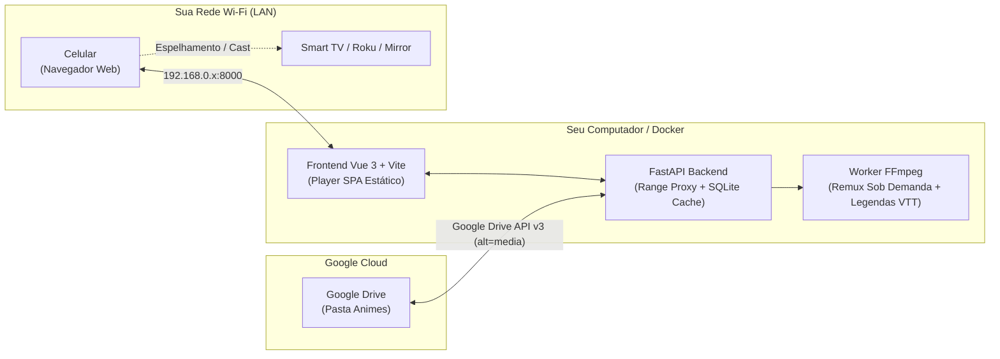

# 🎬 AnimeStream - Servidor Local de Streaming com Google Drive & Docker

[](https://www.docker.com/)
[](https://fastapi.tiangolo.com/)
[](https://vuejs.org/)
[](https://vitejs.dev/)
[](https://www.python.org/)
[](https://ffmpeg.org/)

Aplicação completa de streaming local sob demanda conectada diretamente a uma pasta do **Google Drive**. O servidor roda em container Docker com padrão rigoroso de segurança, permitindo assistir filmes e animes pelo computador, celular ou espelhar via **Screen Mirroring / Chromecast / Smart TV** na mesma rede Wi-Fi.

---

## 📑 Sumário

- [Visão Geral](#-visão-geral)
- [Arquitetura do Sistema](#-arquitetura-do-sistema)
- [Principais Recursos](#-principais-recursos)
- [Blindagem e Segurança (Docker Hardened)](#-blindagem-e-segurança-docker-hardened)
- [Pré-requisitos](#-pré-requisitos)
- [Instalação e Uso com Docker (Recomendado)](#-instalação-e-uso-com-docker-recomendado)
  - [1. Clonar o Repositório](#1-clonar-o-repositório)
  - [2. Configurar a Service Account no Google Cloud](#2-configurar-a-service-account-no-google-cloud)
  - [3. Compartilhar a Pasta no Google Drive](#3-compartilhar-a-pasta-no-google-drive)
  - [4. Configurar Variáveis de Ambiente](#4-configurar-variáveis-de-ambiente)
  - [5. Liberar a Porta no Firewall](#5-liberar-a-porta-no-firewall)
  - [6. Subir o Container](#6-subir-o-container)
- [Como Assistir no Celular e Espelhar na TV](#-como-assistir-no-celular-e-espelhar-na-tv)
- [Desenvolvimento Local sem Docker (Opcional)](#-desenvolvimento-local-sem-docker-opcional)
- [Estrutura do Projeto](#-estrutura-do-projeto)
- [Variáveis de Ambiente](#-variáveis-de-ambiente)
- [Licença](#-licença)

---

## 🌟 Visão Geral

Ao hospedar animes em nuvem no Google Drive, reprodutores comuns enfrentam limitações: arquivos grandes precisam ser baixados por completo, navegadores não suportam contêineres `.mkv` com áudio multi-faixa ou legendas `.ass` avançadas, e o consumo de cota da API gratuita pode ser estourado rapidamente.

O **AnimeStream** resolve isso atuando como uma ponte de alta eficiência:
- **Proxy HTTP 206 (Partial Content / Range Requests)**: O vídeo é transmitido em partes conforme a reprodução avança, permitindo retroceder ou avançar a barra de tempo instantaneamente sem baixar o arquivo todo.
- **Transcodificação Inteligente Sob Demanda**: Se o navegador não suportar o codec de vídeo ou áudio (ex: MKV com HEVC/FLAC), o servidor utiliza FFmpeg para remuxar em tempo real para MP4 fragmentado.
- **Extração de Legendas para WebVTT**: Converte legendas embutidas em `.mkv` para WebVTT nativo renderizado com clareza na tela.
- **Cache Local de Metadados**: Economiza chamadas à API do Google Cloud, agrupando pastas e arquivos em SQLite local por até 30 minutos por atualização.

---

## 🏗 Arquitetura do Sistema



---

## ✨ Principais Recursos

- 📂 **Navegação por Pastas**: Mantém a hierarquia exata de pastas do seu Drive (Anime &gt; Temporada &gt; Episódio) com detecção automática de capas e posters.
- ⚡ **Dual Streaming Mode**:
  - **Modo Direto**: Transmissão pura e ultrarrápida via Range HTTP 206 (zero uso de CPU do PC).
  - **Modo Compatível**: Remux sob demanda via FFmpeg para garantir compatibilidade com navegadores de celulares e TVs.
- 💬 **Legendas e Múltiplos Áudios**: Alternância entre dublagens/idiomas originais e legendas embutidas (.ass/.srt/.vtt) direto na interface.
- ⏱ **Continuar Assistindo**: Salva automaticamente o progresso a cada 5 segundos no SQLite local. Ao terminar um episódio (&gt; 90%), já sugere o próximo da lista.
- ⏭ **Autoplay / Próximo Episódio**: Transição suave com contagem regressiva entre episódios.
- 📱 **Interface Otimizada para Celular & TV**: Design escuro moderno, botões de toque para avanço rápido (+10s / -10s), suporte a Picture-in-Picture (PiP), tela cheia e atalhos de teclado (`Espaço`, `K`, `F`, `Setas`, `N`).
- 📊 **Monitor de Cota**: Indicador integrado mostrando o número total de chamadas feitas à API do Google Drive e status das tarefas.

---

## 🔒 Blindagem e Segurança (Docker Hardened)

A aplicação foi projetada seguindo o **princípio do menor privilégio**:

| Camada | Configuração | Proteção |
|---|---|---|
| **Usuário** | `USER 10001:10001` (sem login shell) | O processo não roda como `root`. Mesmo em caso de falha no app, o invasor não ganha controle do sistema operacional. |
| **Sistema de Arquivos** | `read_only: true` no compose | O sistema de arquivos do container é estritamente somente-leitura. Invasões não conseguem gravar arquivos no disco. |
| **Kernel Linux** | `cap_drop: ALL` e `no-new-privileges: true` | Todas as capabilities administrativas do kernel são revogadas, impedindo escalada de privilégios. |
| **Credenciais** | **Docker Secrets** (`/run/secrets/gdrive_sa`) | A chave de API não é copiada para a imagem do Docker nem exposta em variáveis visíveis via `docker inspect`. |
| **Rede** | `BIND_IP: 192.168.0.x` | A porta 8000 é amarrada estritamente à sua placa Wi-Fi local, evitando exposição em interfaces de VPN (Radmin, Hamachi, ZeroTier) ou na internet pública. |
| **Cabeçalhos HTTP** | Middleware ASGI de Segurança | Headers estritos aplicados em todas as respostas: `Content-Security-Policy`, `X-Content-Type-Options: nosniff`, `X-Frame-Options: DENY`, `Referrer-Policy`. |

---

## 📋 Pré-requisitos

1. **Docker Desktop** (ou Docker Engine + Docker Compose) instalado no computador.
2. Projeto criado no [Google Cloud Console](https://console.cloud.google.com/) com a **Google Drive API** ativada e uma **Chave de Conta de Serviço (JSON)** baixada.

---

## 🚀 Instalação e Uso com Docker (Recomendado)

### 1. Clonar o Repositório

```bash
git clone https://github.com/SEU-USUARIO/anime-streaming.git
cd anime-streaming
```

### 2. Configurar a Service Account no Google Cloud

1. Acesse o [Google Cloud Console](https://console.cloud.google.com/).
2. Crie um projeto (ex: `streaming-anime`).
3. Vá em **APIs e Serviços &gt; Biblioteca**, procure por **Google Drive API** e clique em **Ativar**.
4. Vá em **IAM e administração &gt; Contas de serviço** e clique em **Criar conta de serviço**.
5. Dê um nome (ex: `anime-backend`) e conclua.
6. Clique sobre a conta criada, vá na aba **Chaves &gt; Adicionar chave &gt; Criar nova chave &gt; JSON**.
7. Salve o arquivo baixado dentro da pasta `secrets/` do projeto com o nome:
   ```text
   secrets/gdrive-service-account.json
   ```

### 3. Compartilhar a Pasta no Google Drive

1. Abra o [Google Drive](https://drive.google.com).
2. Localize a pasta onde estão os animes (ex: pasta `Animes`).
3. Clique com o botão direito &gt; **Compartilhar**.
4. Cole o e-mail da sua conta de serviço (encontrado dentro do arquivo JSON no campo `client_email`, com formato `exemplo@projeto.iam.gserviceaccount.com`).
5. Defina a permissão como **Leitor** (Viewer) e desmarque "Notificar pessoas".
6. Clique em **Compartilhar**.

### 4. Configurar Variáveis de Ambiente

Copie o arquivo de exemplo:

```bash
cp .env.example .env
```

Descubra o endereço IP local do seu computador na rede Wi-Fi:
- No **Windows (PowerShell)**: execute `ipconfig` e procure pelo campo *Endereço IPv4* da interface Wi-Fi (ex: `192.168.0.4`).
- No **Linux / macOS**: execute `hostname -I` ou `ifconfig`.

Edite o arquivo `.env`:

```env
# IP da sua máquina no Wi-Fi
BIND_IP=192.168.0.4
PORT=8000

# Nome da pasta compartilhada no Drive (ou deixe vazio e use o ID da pasta)
DRIVE_FOLDER_NAME=Animes
DRIVE_FOLDER_ID=

# Cache da listagem em segundos (1800s = 30min para economia de cota)
LIBRARY_TTL_SECONDS=1800
```

### 5. Liberar a Porta no Firewall

Para permitir que outros aparelhos na mesma rede Wi-Fi acessem a aplicação:

- **Windows 11 (PowerShell como Administrador)**:
  ```powershell
  New-NetFirewallRule -DisplayName "Anime Streaming Local" -Direction Inbound -LocalPort 8000 -Protocol TCP -Action Allow
  ```

- **Linux (UFW)**:
  ```bash
  sudo ufw allow 8000/tcp
  ```

### 6. Subir o Container

Execute:

```bash
docker compose up -d --build
```

Verifique se o container está rodando com saúde:

```bash
docker compose ps
docker compose logs -f
```

Abra no navegador do computador:
```text
http://localhost:8000
```

---

## 📱 Como Assistir no Celular e Espelhar na TV

1. Certifique-se de que o celular está conectado na **mesma rede Wi-Fi** do computador.
2. Abra o navegador do celular (Chrome, Safari, Firefox) e acesse:
   ```text
   http://192.168.0.4:8000
   ```
   *(Substitua pelo seu IP configurado no `.env`)*
3. A interface carregará os episódios e pastas instantaneamente.
4. **Espelhar na TV**:
   - **Smart View / Transmitir Tela (Android)**: Puxe a barra de notificações do celular e toque em **Transmitir / Smart View / Espelhar Tela**, selecionando sua TV.
   - **Navegador da TV**: Abra o aplicativo de navegador da própria TV / Roku / Fire TV e digite diretamente a URL `http://192.168.0.4:8000`.
   - **Google Chrome / Cast**: Toque no botão de menu do Chrome no celular e escolha **Transmitir**.

---

## 💻 Desenvolvimento Local sem Docker (Opcional)

Se preferir rodar os serviços separadamente para desenvolvimento ativo:

### Backend (Python)

```bash
# Requisitos: Python 3.12+ e FFmpeg instalado no PATH do sistema
cd backend
python -m venv .venv
# Windows:
.venv\Scripts\activate
# Linux/macOS:
source .venv/bin/activate

pip install -r requirements.txt

# Defina o caminho das credenciais
set GOOGLE_CREDENTIALS_FILE=../secrets/gdrive-service-account.json
set DATA_DIR=./data

uvicorn app.main:app --reload --host 0.0.0.0 --port 8000
```

### Frontend (Vue 3 + Vite)

```bash
cd frontend
npm install
npm run dev
```

O Vite iniciará em `http://localhost:5173` com proxy automático redirecionando chamadas `/api` para a porta 8000.

---

## 📂 Estrutura do Projeto

```text
anime-streaming/
├── backend/
│   ├── app/
│   │   ├── __init__.py
│   │   ├── config.py         # Validação de variáveis de ambiente com Pydantic
│   │   ├── db.py             # SQLite thread-safe para progresso e cache da biblioteca
│   │   ├── drive.py          # Cliente assíncrono httpx para a Google Drive API v3
│   │   ├── library.py        # Organização de pastas, episódios e busca de capas
│   │   ├── media.py          # Integração FFmpeg/ffprobe (probe, transcode, WebVTT)
│   │   ├── security.py       # Middleware ASGI com cabeçalhos de segurança (CSP)
│   │   └── main.py           # Rotas FastAPI e servidor de arquivos estáticos
│   └── requirements.txt      # Dependências Python travadas
├── frontend/
│   ├── public/               # Favicon e Web Manifest (PWA)
│   ├── src/
│   │   ├── views/
│   │   │   ├── FolderView.vue  # Navegação de pastas, episódios e 'Continuar assistindo'
│   │   │   └── PlayerView.vue  # Player com modo direto/compatível, áudios e legendas
│   │   ├── App.vue             # Header fixo, sincronização e modal de métricas
│   │   ├── router.js           # Rotas Vue Router
│   │   ├── style.css           # Tema escuro responsivo
│   │   └── main.js
│   ├── package.json
│   └── vite.config.js
├── secrets/                  # Chave da Service Account (ignorado pelo git)
│   └── gdrive-service-account.json
├── .dockerignore
├── .gitignore
├── .env.example
├── docker-compose.yml        # Orquestração do container com hardening completo
├── Dockerfile                # Multi-stage build (Node build -> Python slim + FFmpeg)
└── README.md
```

---

## ⚙️ Variáveis de Ambiente

| Variável | Padrão | Descrição |
|---|---|---|
| `BIND_IP` | `127.0.0.1` | Endereço IP da interface de rede local no host para publicação da porta. |
| `PORT` | `8000` | Porta exposta na rede local. |
| `DRIVE_FOLDER_NAME` | `Animes` | Nome da pasta raiz compartilhada com a Service Account no Google Drive. |
| `DRIVE_FOLDER_ID` | `""` | ID opcional da pasta no Drive (dispensa busca por nome se preenchido). |
| `LIBRARY_TTL_SECONDS`| `1800` | Tempo de vida em segundos do cache da biblioteca (1800s = 30 min). |
| `MAX_TRANSCODES` | `2` | Número máximo de sessões simultâneas de transcodificação FFmpeg. |
| `MAX_SUBTITLE_JOBS`| `2` | Número máximo de extrações simultâneas de legendas. |
| `TRANSCODE_PRESET` | `veryfast` | Preset de codificação do libx264 (`ultrafast`, `veryfast`, `medium`). |
| `TRANSCODE_CRF` | `23` | Fator de qualidade CRF para a transcodificação (18-28). |
| `LOG_LEVEL` | `info` | Nível de logs do backend (`debug`, `info`, `warning`, `error`). |

---

## 📄 Licença

Este projeto está sob a licença **MIT**. Consulte o arquivo `LICENSE` para mais informações.
